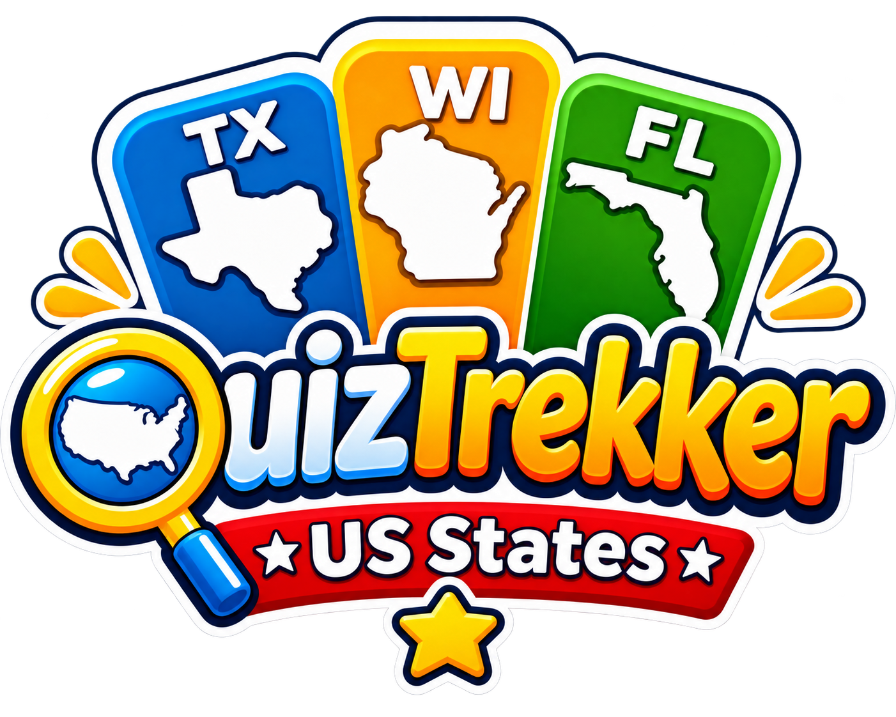

<p align="center">
  
</p>
<p align="center">
  <a href="https://natsteff.github.io/statequest/">
    
  </a>
</p>

# StateQuest

A browser geography game for all 50 U.S. states. Learn silhouettes, postal abbreviations, names, capitals and locations, then practice with multiple choice or typed abbreviations. Shape Challenge and Neighboring States cover all 50 states before starting a new random order. Scores, streaks and explored states are stored in the current browser.

## Run locally

Requires Python 3.9 or later. No package installation is needed.

```sh
python3 scripts/build.py
python3 -m http.server 8000 --bind 127.0.0.1 --directory dist
```

Open http://127.0.0.1:8000. Serve only `dist`, which contains the playable static application. Build identity is in `dist/build.json`.

Swipe or use Previous/Next in Learn Mode; tap a card to flip it. The state selector jumps directly to any state. The shape challenge accepts two-letter postal abbreviations without regard to case. Each answer scores once; a miss resets the current streak. A correct answer earns 100 points plus 10 for each additional consecutive answer, capped at a 100-point bonus. The personal best is the largest cumulative score reached during a visit; returning visits start a new score while retaining streak and history.

Shapes fit their cards by default without stretching or rotation. “Compare at map scale” uses a common map-coordinate scale for all silhouettes. Alaska and Hawaii use the source map’s insets; Alaska is reduced. Small islands and borders reflect the source's cartographic simplification.

Progress is specific to this browser and origin. Clearing browser data removes it. If storage is blocked, the game continues for the visit and displays a notice. There are no accounts or network score services. The first online visit caches the bundled game for offline play. Browser storage eviction can remove saves and cached files; use Export save to keep a backup.

## Checks

```sh
python3 -m unittest discover -s tests -p 'test_*.py'
node tests/core.test.cjs
node tests/pwa.test.cjs
node tests/games.test.cjs
node tests/rounds.test.cjs
node tests/updates.test.cjs
```

The Python tests cover the 50-state data build and representative geometry. The JavaScript tests cover scoring, streaks, answer normalization, saved practice history and storage failures. JavaScript tests require Node (only tests require it).

## Geography attribution

Boundary data: [US Atlas 3.0.1](https://github.com/topojson/us-atlas), derived from the U.S. Census Bureau’s 2017 cartographic boundaries, projected with Albers USA. The pinned TopoJSON is in `data/`; `scripts/build.py` decodes its arcs to bundled SVG paths, retaining all rings and the original map coordinates. Copyright 2013–2019 Michael Bostock, ISC license; see [license](dist/US-ATLAS-LICENSE.txt). Names, abbreviations and capitals are maintained in `data/states.tsv`.

## Mobile installation and backups

Phones start in Card view: one large flashcard fills the available game area, with Learn, Play and My Progress controls at the bottom. Overview switches to the wider dashboard; the chosen view stays on this browser. My Progress contains scores, backups, settings and installation help. Buttons use bold colors, tactile borders and large touch targets. Card geometry remains accurate. On iPhone, use Safari’s Share → Add to Home Screen; on Android, use the browser’s Install app/Add to Home screen menu. Installation availability depends on the browser. HTTPS or localhost is required for offline setup. After the offline-ready message appears, the bundled game can reopen without a connection. Updates become active after all game windows close and reopen; an update notice appears when detected.

Export save downloads a versioned JSON backup. Transfer that file yourself to another device and choose Import save. A validated summary and confirmation precede replacement; import restarts the current visit’s challenge score. Malformed, oversized and unsupported-version files are rejected. Save files are processed entirely on the device. Import replaces rather than merges progress; export first to retain the old journal.

## GitHub Pages preparation

Publish the **contents of `dist/`** as a static Pages artifact. All asset URLs, manifest scope/start URL and service-worker scope are relative, supporting a project path such as `/statequest/` without code changes. The worker caches only bundled game assets and deletes only older caches for its own project path. The GitHub Actions workflow tests and rebuilds the game, verifies reproducibility, and publishes only `dist/` to Pages when `main` changes. Verify install/offline behavior on the final HTTPS URL before release.

Physical iPhone/Android checks remain necessary for home-screen installation, soft-keyboard behavior, safe areas, larger system text and touch gestures. Browser viewport checks alone do not establish physical-device compatibility.

## State facts and mini-games

Flip a Learn card to see up to four fact groups. In **My Progress → Options → Card Facts**, uncheck a group to make room for another; Restore Defaults selects flag, nickname, statehood and population. Choices stay in this browser. **More Facts** is always beside the state name and shows the unselected groups, ten largest cities/communities, a selected NPS landmark and neighboring states. Fact choices are separate from the progress JSON backup.

In **Play**, choose Shape Challenge, Population Showdown, Size Showdown, Neighboring States or Statehood Timeline. Showdowns compare July 2025 state populations or Census 2010 total area (land + water). Neighbors include shared water boundaries and exclude corner-only contact. Alaska and Hawaii have no neighboring U.S. states. Every question has one correct answer; answers reveal the figures or complete neighbor list. All games contribute points/streaks; only Shape Challenge answers update per-state practice history.

See the in-app [Image/Data Credits](https://natsteff.github.io/statequest/credits.html) for exact Census/ACS vintages, Hawaii and Rhode Island geography exceptions, CRS statehood dates, Flagpedia attribution, symbol references and map licenses. No live data service, Census API key or external flag request is needed during play. Cached credits work offline; outbound source/landmark links need a connection.

Fact data is checked into `data/state-facts.json`; `scripts/build.py` packages it and all 50 original SVGs from `public/assets/flags/`. To refresh the pinned sources, run `python3 scripts/refresh_facts.py --download`, review changes and source vintages, run tests, then rebuild. This maintenance operation uses the network and is separate from the normal offline build. See [data methods](data/README.md).

## Rounds, timelines and startup updates

Showdowns accept either the large state card (including its flag/image) or its answer button. Each question scores once.

Shape Challenge and Neighboring States have independent shuffled 50-state decks. A state is completed after an answer, including a miss. The next cycle uses a new shuffled order, avoiding an immediate repeat across the boundary. Deck order/position is saved locally; reloading or switching games resumes the current unanswered state. ONE/ALL neighbor modes share one deck. Old practice counts remain, but no state receives an early repeat. Deck positions are device-local and separate from the exported progress backup.

In Neighboring States, choose **ALL neighbors**, toggle every correct state, then Check. There are 10 options (the current maximum of eight neighboring states plus two). “None — no neighboring states” is exclusive and handles Alaska/Hawaii. Partial sets or extra wrong selections do not count as correct.

Statehood Timeline gives four states per round. Tap them from earliest to latest admission date, use Undo/Clear to revise, then Check. Same-date states (North/South Dakota) are accepted in either order. Reference dates come from the existing CRS-backed statehood data; original 13 dates mean Constitution ratification.

**My Progress → Game settings → Auto-update on startup** is enabled by default. It checks/stages the offline worker without the browser HTTP cache and applies a fully installed waiting update during a short pre-play window. A successful activation reloads once; ongoing quizzes are never forcibly reloaded. Offline/slow checks fall back within eight seconds, or choose Play now. Turning the setting off stops the app's automatic startup apply/reload; the browser may still stage service-worker updates and activate them after all game windows close. An existing pre-0.5 installation may need one online visit followed by closing/reopening all game windows to receive this new updater.

Questions appear directly below the game controls and before the choices. Showdowns use only the two large state cards as answer controls. ALL Neighbors retains a smaller state silhouette above its ten choices, with scrolling on short screens. Timeline marks the chosen state buttons with selection numbers 1–4; Undo/Clear revises that sequence without a separate list of slots.

Capitals are always labeled on both sides of Learn cards, using USGS National Map capitol-building coordinates and the same Albers USA projection as the outlines. All 50 points are checked against their displayed state polygons. The logo is static. Mobile devices start in Card view; enable **Options → Game settings → Show view switcher** to access Overview. Each Shape Challenge and Neighboring States variant has its own entry in the Game menu.
